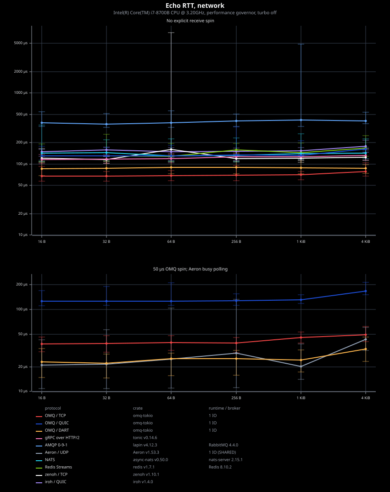
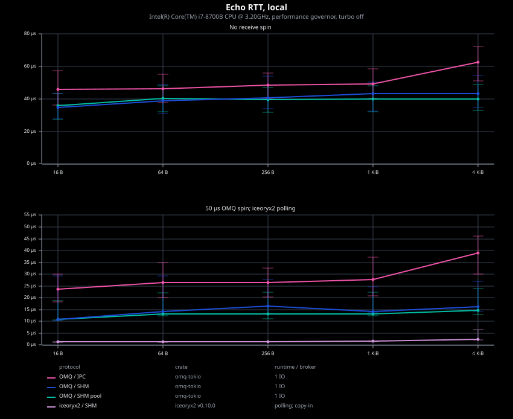
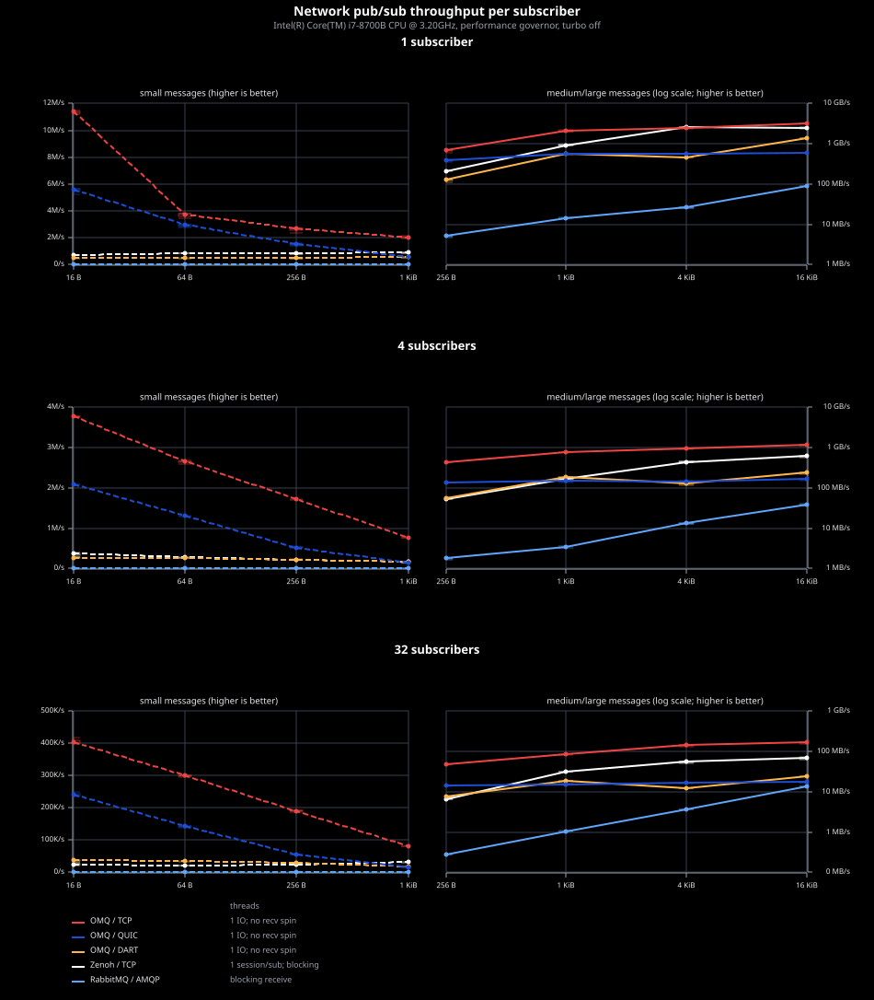
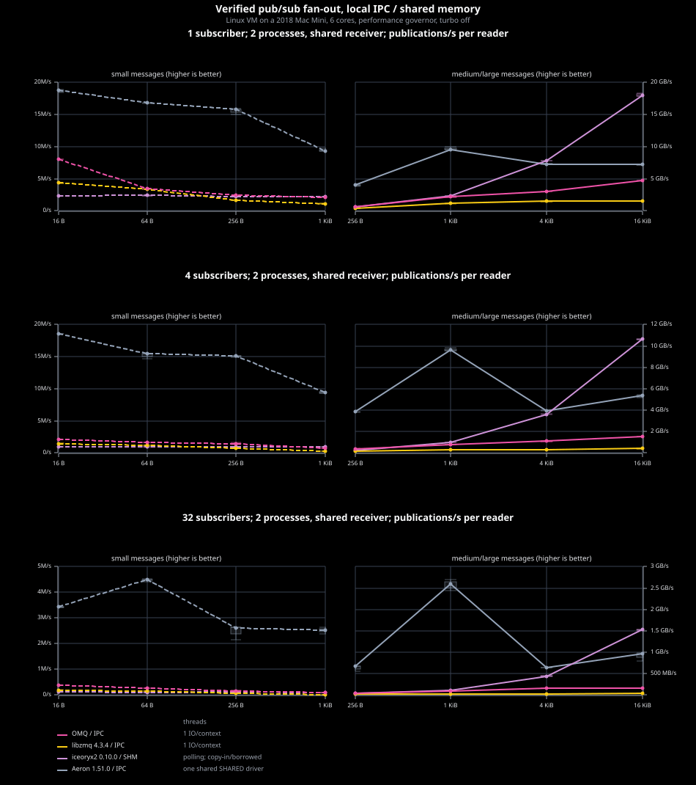

# Other Protocol Comparisons

- Same-host measurements; delivery and persistence semantics differ.
- Workloads: [adapters](scripts/rivals/README.md) and
  [run commands](RUNNING_BENCHMARKS.md).

## One-flow PUSH/PULL throughput

- Network: TCP/QUIC/DART and external protocol peers.
- Local: IPC/SHM; OMQ uses SCATTER/GATHER.
- iroh counts fixed-size stream writes; the other series count messages.

## Request/reply RTT

- One outstanding request; OMQ uses CLIENT/SERVER.
- Network: top without spin; bottom with 50 μs OMQ receive spin (DART also
  spins IO) and Aeron busy polling. All lines are solid.
- Local: no spin above; 50 μs OMQ spin and iceoryx2 polling below. Solid lines.
- Lines show p99 RTT; whiskers span p50 to p99.9. Network axes are logarithmic;
  local axes are linear with 20 μs top and 5 μs bottom ticks.

## Verified PUB/SUB fan-out

- One publisher, 1/4/32 subscribers; rates and bytes are **per subscriber**.
- Every subscriber verifies count, order, size, and a sentinel.
- Rates include the slowest subscriber's drain; whiskers span three verified
  rounds. OMQ uses HWM 1000 and blocking receive.
- Byte rates count logical payloads. SHM copies on publication; subscribers
  borrow mapped storage.

