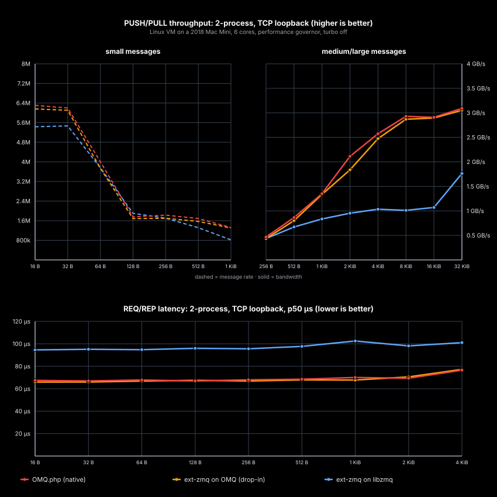

# OMQ for PHP

PHP code written for the PECL `zmq` extension (ext-zmq) runs on OMQ two ways:

- **OMQ.php** ([`native/`](native)): a `zmq` extension written in Rust on
  `omq-libzmq`. It registers as `zmq` with ext-zmq 1.1.3's classes, so
  existing code and Composer's `ext-zmq` requirement work unchanged.
- **Drop-in**: the stock ext-zmq loading `libomq_zmq` as `libzmq.so.5`.

<p align="center">
  
</p>

## OMQ.php

Install a prebuilt build with [PIE](https://github.com/php/pie), in place of
ext-zmq, never next to it:

```sh
pie install paddor/omq-binding.php
```

Prebuilt binaries cover PHP 8.2 to 8.5, NTS and ZTS, on x86_64 and arm64
Linux (glibc 2.35 or later, or musl), and NTS on arm64 macOS.

To build it, install `php-config` (`php-dev`) and libclang, then load the
result the same way:

```sh
cargo build --release --manifest-path bindings/php/native/Cargo.toml
php -d extension=/path/to/target/release/libomq_php.so app.php
```

With several LLVM versions installed, bindgen can mix one version's libclang
with another's headers; `export $(bindings/php/scripts/libclang-env.sh)`
pins both to one.

- Contexts start on first use and belong to the process that created them,
  so PHP-FPM workers forked after startup each get their own. Persistent
  contexts and sockets live per worker and close at shutdown.
- Covers ext-zmq's API: `ZMQContext`, `ZMQSocket`, `ZMQPoll` (sockets and
  streams), `ZMQDevice`, monitors, CURVE, `SOCKOPT_FD` streams for ReactPHP
  and Revolt. Not `ZMQCert`/`ZMQAuth`, which need czmq.
- `new ZMQSocket(..., $on_new_socket)` hands the callback a second
  `ZMQSocket` for the same native socket.

Architecture: [`doc/architecture.md`](doc/architecture.md).

## Drop-in

Install ext-zmq from your distro (`php-zmq` on Debian/Ubuntu, `php-pecl-zmq`
from Remi), then stage OMQ:

```sh
omq-libzmq/scripts/stage-compat.sh --release /opt/omq
LD_LIBRARY_PATH=/opt/omq/lib php app.php
```

For PHP-FPM, set the variable in the service environment, for example a
systemd drop-in with `Environment=LD_LIBRARY_PATH=/opt/omq/lib`. Leave the
system `libzmq.so.5` in place for other programs.

## Both

- OMQ transports through plain endpoint strings: `lz4+tcp://`,
  `zstd+tcp://`, `ws://`, plus `tcp://`, `ipc://`, and `inproc://`.
- `ZMQ::LIBZMQ_VERSION` reports the libzmq ABI version that OMQ implements.
- ext-zmq's API exposes the classic socket types and options only, so
  CLIENT/SERVER, RADIO/DISH, SCATTER/GATHER, CHANNEL, PEER, and OMQ-specific
  options are out of reach. C ABI gaps are in
  [`omq-libzmq/doc/compatibility.md`](../../omq-libzmq/doc/compatibility.md).

## Development

```sh
scripts/test-php.sh                       # both modes, ext-zmq's .phpt suite, a PHP-FPM check
ruby scripts/test-php-matrix.rb --all     # build and test in PHP 8.2-8.5 NTS/ZTS glibc/musl images
ruby bindings/php/scripts/update_perf.rb  # benchmark and chart
```

`OMQ_PHP` names a PHP command with ext-zmq loaded for the drop-in mode, for
example `OMQ_PHP="php -d extension=zmq.so"`. `tests/phpt` holds ext-zmq's
BSD-licensed tests, adapted for PHP 8; three XFAIL tests name the engine
differences behind them. `scripts/test-extension.sh` runs the tests on any
built `zmq.so`; the matrix and the PIE release workflow use it, and
`test-php-matrix.rb --pie VERSION` checks a published release. Benchmark
rows go to `~/.cache/omq.php/bindings.jsonl`.
