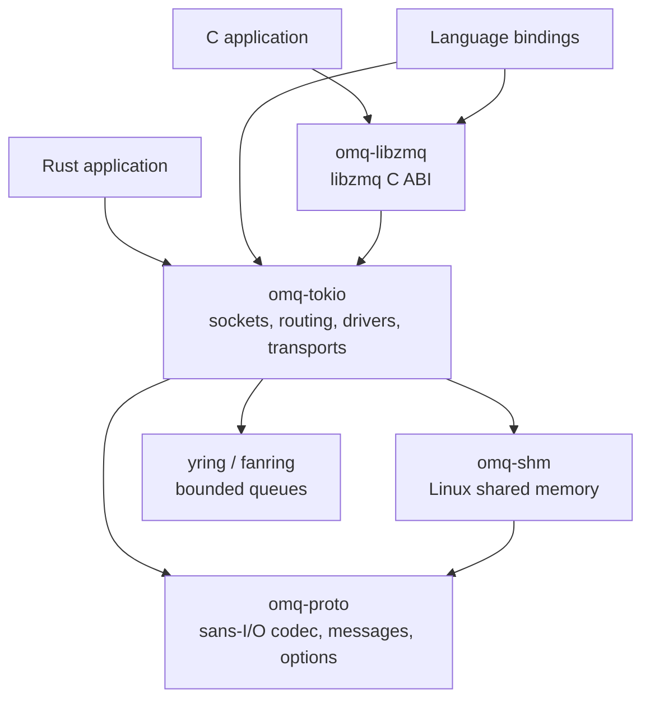
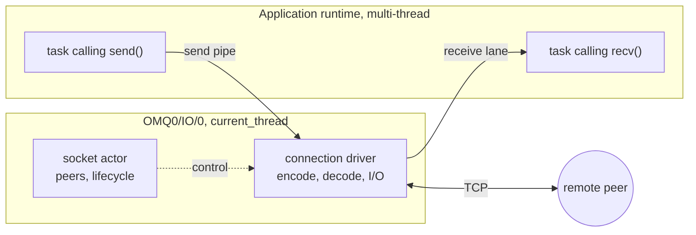
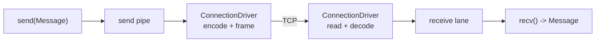
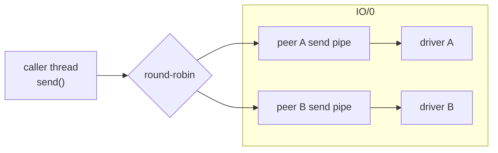
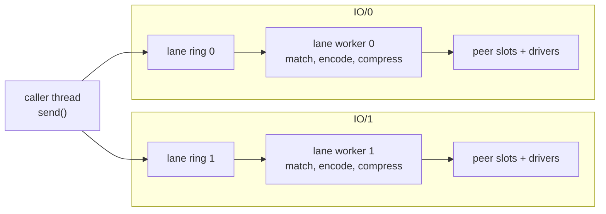
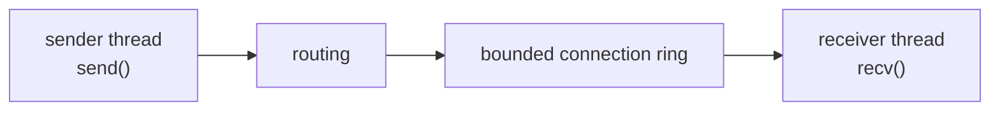

# Architecture

OMQ sockets exchange complete messages. Applications choose a transport by URI;
the socket owns routing, connections, framing, and backpressure. This page maps
components, threads, and message paths. Protocol details live in the transport
RFCs; C and language bindings are covered in [bindings.md](bindings.md).

## Components

| Component | Responsibility |
| --- | --- |
| `omq-proto` | ZMTP codec, messages, options, mechanisms, and transforms |
| `omq-tokio` | Async and blocking sockets, routing, I/O drivers, and reconnects |
| `omq-shm` | Shared mappings, payload storage, and remote leases; isolates unsafe mapping code |
| `omq-libzmq` | libzmq-compatible C API |
| `bindings/` | Language APIs over `omq-tokio` or `omq-libzmq` |
| `omq-bench` | Benchmark peers, result storage, and charts |

The codec owns no socket or runtime. The queue crates live in the
[fanring.rs workspace](https://github.com/paddor/fanring.rs).

## Threads and runtimes

`ContextCore` owns runtime resources, socket actors, and the context's
`inproc://` namespace. `Context` handles share it.

| Construction | Runtimes | Fan-out lanes |
| --- | --- | --- |
| `Context::new()` | One `current_thread` runtime on `<name>/IO/0` for control and I/O | One |
| `ContextConfig { io_threads: N }`, N > 1 | `<name>/Ctrl` plus N `current_thread` I/O runtimes | One per I/O runtime |
| `Context::current()` | The caller's runtime; no owned threads | One |

A typical async application runs its own multi-thread Tokio runtime next to
OMQ's default context with one I/O thread:

With N > 1 I/O threads, the socket actor moves to its own `OMQ0/Ctrl` thread,
and each `OMQ0/IO/i` thread runs its own drivers and fan-out lane. Application
threads enqueue and dequeue messages; encoding, compression, and wire I/O run
on the I/O runtimes. Wakeups cross runtimes through signals, so application
workers never run OMQ tasks.

The socket actor runs on the control runtime. Connection drivers, raw STREAM,
UDP/DART endpoints, and fan-out lanes are pinned to one I/O runtime for life,
assigned least-loaded at connect or accept. I/O runtimes do not steal tasks
from one another. A borrowed context runs everything on the caller's runtime.
Blocking sockets use the same backend. Owned contexts can share ingress and
egress byte buckets across network transports; IPC, inproc, and SHM bypass
them.

## Message paths

An ordinary TCP PUSH/PULL exchange:

The socket actor owns the peer table, endpoint lifecycle, identities,
subscriptions, groups, and monitor events. It does not touch every payload.
The caller enqueues an unencoded `Message`; drivers or fan-out lanes encode,
compress, and write. REP and ROUTER receives pass through the actor for route
state; other receives go straight to the socket's receive lanes.

Data and control use separate bounded queues in both directions. Handshakes and
protocol commands reach the actor through a control mailbox, so data
backpressure cannot hide connection management or shutdown. Delivery keeps
each connection's order.

A latency-profile plain-TCP peer may write once directly from the caller with
a nonblocking vectored write; the driver owns any unfinished output.

## Routing and fan-out

| Policy | Socket types | Destination |
| --- | --- | --- |
| Round-robin | PUSH, DEALER, REQ, CLIENT, SCATTER | One eligible peer |
| Fan-out | PUB, XPUB, RADIO | Matching subscribers or groups |
| Identity or reply route | ROUTER, REP, SERVER, PEER | Selected peer or saved request route |
| Exclusive | PAIR, CHANNEL | One peer |

Round-robin peers have bounded send pipes. Connect-side pipes exist before the
peer binds, so early sends keep their order; a bind-side socket without a ready
pipe is mute. HWM bounds each pipe, not total socket memory.

A PUSH socket on one I/O thread picks one ready peer per message:

A PUB socket with two I/O threads publishes into one ring per lane. Each lane
worker matches subscriptions, encodes, compresses, and fills the transmit
slots of the peers pinned to its thread:

The caller pushes each publication into every active lane's ring under one
lock, so lanes see publications in socket order. Each lane encodes and
compresses on its own, once per compatible codec group. Lanes share no
encoder or compression state, so they never lock each other; repeating the
compression per lane costs less than a shared encoder. A slow subscriber
cannot stop the others: fan-out drops for muted peers unless `xpub_nodrop` is
set. Lane control uses its own channel, drained every iteration.

PUB and XPUB pass each peer SUBSCRIBE through `Options::subscription_admission`
before registration; rejected ones never reach XPUB receive and surface as
`SubscribeRejected` monitor events.

ROUTER routes by identity, SERVER by routing ID, and REP by the saved request
route. PEER routes by identity in both directions; outbound PEER sends use
per-clone, per-destination queues. A replacement identity invalidates the old
route. Received identities carry immutable `PeerInfo` snapshots.

## Receive ownership and backpressure

PULL, GATHER, SUB, XSUB, and PEER give each connection a bounded receive lane.
Receives drain lanes fairly with FIFO order per connection. Socket clones
share the drain. PEER, PULL, and GATHER can claim a lane with
`recv_with_receipt` and pause it while the application decides; the claim
belongs to one connection generation. See the
[receive backpressure contract](../DEVELOPMENT.md#receive-lane-backpressure).

Backpressure is per connection: a full lane stops reading from that
connection only, then its transport buffers and the sender's queues fill while
other peers keep flowing. PULL and GATHER bound each lane by `recv_hwm`
messages; PEER also bounds each connection by bytes. No socket-wide budget
couples peers, and transport buffers are outside these budgets.

Round-robin and exclusive sends wait when mute; nonblocking sends report
`Full`. Fan-out applies its drop or block policy. Peer loss and slow consumers
never become send errors; sockets reconnect and replay subscriptions and
groups.

Close stops new sends. Nonzero linger lets accepted output drain under one
socket-wide deadline; zero linger cancels at once. Wire completion does not
prove remote delivery. Heartbeats detect silent peers, not slow ones.

## Message storage and wire work

Small bodies live inline in `Message` or `Payload`; larger bodies use shared
storage, so cloning does not copy. `PayloadPool` provides fixed storage
classes with an owned fallback, and `Options::recv_payload_pool` supplies
receive destinations. On Linux, `shm_payload_pool` backs the same pool with
sealed memfds that work over every transport. `FrameBuffer` arenas hold
headers and small bodies; large bodies go out by gather write.

LZ4 and Zstd compress complete messages before ZMTP framing and batch small
messages into bounded arenas. Dictionaries ship once per connection and
direction. Zstd drivers adapt their level to the bottleneck; fan-out lanes use
a fixed level. Wire formats: [LZ4 RFC](lz4-rfc.md), [Zstd RFC](zstd-rfc.md).

## Batching and signals

OMQ batches naturally: the application sends one message at a time, and
batches form from whatever queues up while a task is busy. Nothing waits to
fill a batch, so an idle socket sends at once and a loaded one sends in bulk.

- **Send:** callers append to a ring. `DataSignal` wakes the driver only on
  the empty-to-pending edge, so a burst of sends costs one wakeup. Queued
  small messages collect in one `FrameBuffer` arena, and the driver writes
  everything queued with one vectored write.
- **Compression:** LZ4 and Zstd pack queued small messages into one arena,
  which also improves the ratio.
- **Fan-out:** a lane worker drains its ring in batches and encodes each batch
  once per codec group.
- **Receive:** one read decodes many frames, and the driver publishes them to
  the receive lane once per batch. `recv_many_into` and `recv_batching` let
  the application take bursts too.

Messages cross threads through bounded `yring` and `fanring` rings. Each I/O
thread owns its drivers and lane outright, so I/O threads never contend with
each other. The remaining locks guard short appends: a peer's transmit slot, a
ring producer shared by socket clones, and publication across lanes.

Every drain loop is bounded by message and byte budgets, so tasks revisit
control, shutdown, and the other I/O direction. A task blocked on a full queue
keeps its pending item; retries keep order and never decode twice.
`StateSignal` reports capacity and route changes. Signals schedule work;
queues own the messages.

## Inproc

Inproc moves owned messages without ZMTP or kernel I/O. The receiving socket
owns one ring per connection direction, sized from the sender's send HWM and
the receiver's receive HWM. Sends enqueue on the caller's thread; receives
drain on the receiver's thread. Direct routes never pass a message through
an I/O-thread task.

Fan-out senders match subscriptions on the calling thread and push into each
subscriber ring. Setup, subscription commands, and lifecycle run on the
context runtime. PEER and `conflate` relay through peer tasks with separate
data and control queues. Each context has its own inproc namespace.

## Other execution paths

- `omq_tokio::exclusive::Socket` is caller-driven: it owns one TCP stream
  through `&mut self` with no background task. The caller runs `maintain()`
  for reconnect and heartbeats.
- `Proxy` joins two sockets without an unbounded queue. A blocked direction
  holds one pending message while the other direction and the control socket
  keep running.
- `Socket::send_ready` and `wait_send_ready` report `try_send` admission.
  C and Python sockets use libzmq-compatible admission instead.

## Monitoring

`Socket::monitor()` streams lifecycle events through a bounded, lossy queue
(`Options::monitor_capacity`). Consumers that track the connection set use
`connections()` with `connections_generation()` and `connections_changed()`,
which never lag. `wait_connected()` gates on readiness.

## Transports

| URI family | Path |
| --- | --- |
| `tcp://`, `ipc://` | Byte streams with ZMTP framing |
| `shm://` | Unix rendezvous, shared carrier ring and payload references (Linux, all but STREAM) |
| `ws://`, `wss://` | ZWS over WebSocket, optionally TLS |
| `quic://` | ZMTP byte stream over QUIC (Quinn, TLS 1.3) |
| `inproc://` | Context-local message transfer without ZMTP |
| `udp://` | RADIO/DISH datagrams |
| `dart://` | Reliable ordered messages over UDP |
| `lz4+...`, `zstd+...` | Message transforms over supported carriers |

STREAM uses raw TCP without a ZMTP handshake. SHM sets up connections over
Unix sockets and moves messages through shared memory; received messages keep
their storage until released ([omq-shm](../omq-shm/README.md)). QUIC uses a
separate liveness stream so heartbeats ignore receive backpressure
([quic-rfc.md](quic-rfc.md)). Each DART endpoint task drives all its peers'
sans-I/O sessions with bounded receive credit ([dart-rfc.md](dart-rfc.md)).

## Source map

| Question | Start here |
| --- | --- |
| Who owns runtimes and threads? | [context.rs](../omq-tokio/src/context.rs) |
| What does a socket call do? | [handle.rs](../omq-tokio/src/socket/handle.rs), [blocking.rs](../omq-tokio/src/blocking.rs) |
| Who manages peers and lifecycle? | [socket/actor/](../omq-tokio/src/socket/actor/) |
| Where are queues drained and bytes written? | [engine/](../omq-tokio/src/engine/) |
| How are peers selected? | [routing/](../omq-tokio/src/routing/) |
| How are receives managed? | [fanin.rs](../omq-tokio/src/socket/fanin.rs), [recv.rs](../omq-tokio/src/socket/recv.rs), [peer_recv.rs](../omq-tokio/src/socket/peer_recv.rs) |
| How are payloads stored and framed? | [message.rs](../omq-proto/src/message.rs), [frame_buffer.rs](../omq-proto/src/frame_buffer.rs) |
| Where are codec and transport rules? | [proto/connection/](../omq-proto/src/proto/connection/), [transport/](../omq-tokio/src/transport/) |
| How do I test or measure a change? | [DEVELOPMENT.md](../DEVELOPMENT.md), [RUNNING_BENCHMARKS.md](../RUNNING_BENCHMARKS.md), [perf-verification.md](perf-verification.md) |
