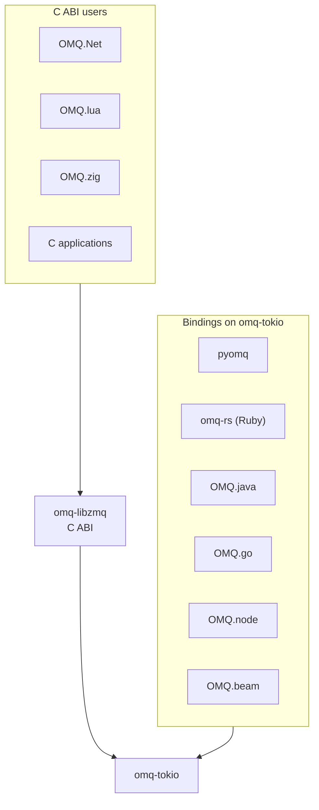

# Bindings

Every binding runs the same Rust engine. Most call `omq-tokio` directly; some
go through the libzmq-compatible C ABI in `omq-libzmq`. Either way, routing,
reconnects, and wire I/O run on OMQ-owned threads, as described in
[architecture.md](architecture.md#threads-and-runtimes).

| Binding | Language | Base | Package |
| --- | --- | --- | --- |
| [pyomq](../bindings/pyomq) | Python | `omq-tokio` | PyPI `pyomq` |
| [omq-rs](../bindings/ruby) | Ruby | `omq-tokio` | RubyGems `omq-rs` |
| [OMQ.java](../bindings/java) | Java | `omq-tokio` | Maven `io.github.paddor:omq-java` |
| [OMQ.go](../bindings/go) | Go | `omq-tokio` | Go module `github.com/paddor/omq.rs/bindings/go` |
| [OMQ.node](../bindings/node) | Node.js | `omq-tokio` | npm `@paddor/omq-node` |
| [OMQ.beam](../bindings/beam) | Erlang, Elixir, Gleam | `omq-tokio` | Hex `omq`, `omq_elixir`, `omq_gleam` |
| [OMQ.Net](../bindings/dotnet) | .NET | `omq-libzmq` | NuGet `Omq.Net` |
| [OMQ.lua](../bindings/lua) | Lua 5.4 | `omq-libzmq` | LuaRocks `omq` |
| [OMQ.zig](../bindings/zig) | Zig | `omq-libzmq` | Git tag `omq-zig-v*` |

Each binding has a `doc/architecture.md` for its own ownership and threading
details.

## Ownership

Each binding owns a native `Context`, and that context owns its background
I/O threads. Language threads only call in. Bindings loaded into the same
native library image can share one context through `Context::share_key()` and
`Context::from_share_key()`; sharing a context shares its runtime and
`inproc://` namespace without changing each binding's ownership rules.

The C API keeps libzmq's rules: a socket is used by one thread at a time.
Native `omq-tokio` handles can be shared by async callers.

## Values

Bindings convert values at their API boundary. They either copy payload bytes
or retain native owners behind views. Batch APIs reduce call overhead; they do
not imply copy-free conversion.

## Options and readiness

Bind and connect capture the effective socket options. Changing a C socket's
options later does not reconfigure active connections.

C and Python sockets choose libzmq-compatible send admission at construction:
sends stay lossy where libzmq is lossy, and writability matches libzmq for
`zmq_poll`, `ZMQ_EVENTS`, and `Poller`. Native sockets report `try_send`
admission through `send_ready` instead.

## libzmq compatibility

- [omq-libzmq README](../omq-libzmq/README.md): build, link, and drop-in use.
- [Semantics](libzmq/semantics.md), [gaps](libzmq/gaps.md),
  [errors](libzmq/errors.md), and [performance](libzmq/perf.md).

Binding release steps are in [RELEASING.md](../RELEASING.md#binding-releases).
